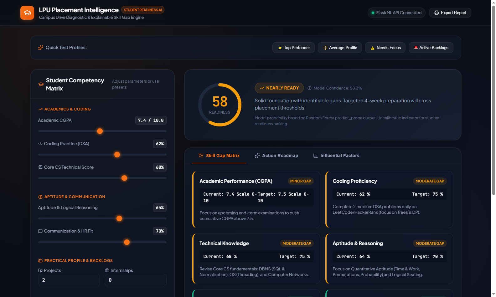
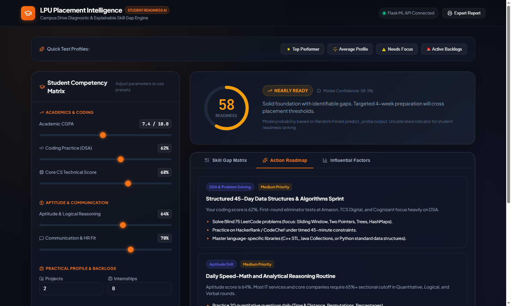
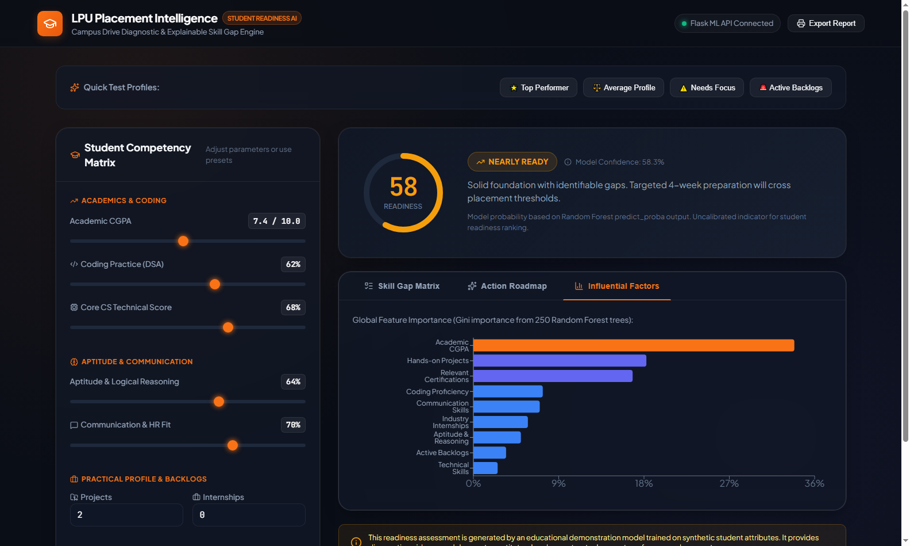

<div align="center">

# 🎓 LPU Placement Intelligence
### Student Readiness Prediction & Skill Gap Analysis Platform

[](https://python.org)
[](https://flask.palletsprojects.com)
[](https://vitejs.dev)
[](https://scikit-learn.org)
[](LICENSE)

<br/>


<br/>

An end-to-end **Machine Learning web application** designed to evaluate a student's preparedness for campus placement drives, identify specific skill gaps against institutional benchmarks, and generate transparent, actionable improvement roadmaps.

</div>

---

## 🚧 Production-readiness status

**Final review decision: NO-GO for institutional production.** The repository
is suitable for continued development and a controlled technical pilot only
after the pilot checklist is approved. See the [final release readiness
review](docs/FINAL_RELEASE_READINESS.md) for completed evidence and blocking
gaps.

The frontend phases 13–18 have a separate evidence record: build, test,
accessibility, performance, deployment, and telemetry gates pass. Local
credential authentication with server-enforced roles and cohort scoping is
implemented; institutional SSO, the usability pilot, and the staging deploy
remain blockers. See the [frontend sign-off](docs/FRONTEND_SIGN_OFF.md) and
[AUTHENTICATION.md](docs/AUTHENTICATION.md).

This repository currently contains a working educational prototype. The live API uses the nine-feature schema in `dataset/students.csv`, which contains 253 records. Data provenance and the construction of the `placement_ready` label must be verified before the model is used for institutional decisions.

The current prototype provides threshold-based skill gaps, student-specific model explanations, persistent assessment history, role-based workspaces, cohort-scoped mentor access, shared action plans and follow-ups, a manually maintained placement pipeline, and a basic access audit. Target-role thresholds are provisional project choices. It does not connect to institutional SSO/MFA, a consent-management service, external verified student records, or a retention/deletion workflow. See [connected workspace behavior](docs/MENTOR_ANALYTICS.md), the [governance baseline](docs/GOVERNANCE_BASELINE.md), [AUTHENTICATION.md](docs/AUTHENTICATION.md), and [production release criteria](docs/RELEASE_CRITERIA.md) before extending or deploying the system.

## 📸 Application Screenshots

<table>
<tr>
<td align="center" width="50%">

<br/><b>🏠 Main Dashboard — Student Competency Matrix</b>
</td>
<td align="center" width="50%">

<br/><b>🔍 Skill Gap Matrix — Gap Severity Analysis</b>
</td>
</tr>
<tr>
<td align="center" width="50%">

<br/><b>🗺️ Personalized Action Roadmap</b>
</td>
<td align="center" width="50%">

<br/><b>📊 Influential ML Factors Chart</b>
</td>
</tr>
<tr>
<td align="center" colspan="2">

<br/><b>🔴 Needs Focus — Profile Analysis View</b>
</td>
</tr>
</table>

---

## 🌟 Key Features

| Feature | Description |
|---|---|
| 🎛️ **Competency Matrix Dashboard** | Interactive sliders for 9 student parameters with live sync |
| 🤖 **ML Inference Engine** | Gradient Boosting prototype trained on `students.csv`; metrics are preliminary and must be reproduced with the canonical evaluation pipeline before production use |
| 🔍 **Skill Gap Matrix** | Compares student params against placement cutoffs |
| 🗺️ **Action Roadmap** | Prioritized 30–60 day improvement plans |
| 🧭 **Target-role fit** | Compare one or more selected roles against clearly marked starter thresholds |
| 🧑‍🏫 **Mentor workspace** | Cohort-scoped mentee list, support queue, goals, private notes, and follow-up history |
| 🏢 **Placement workspace** | Cohort readiness, aggregate coverage, model metadata, and manually recorded placement stages |
| 📄 **Report Export** | Print-optimized diagnostic scorecard |
| ⚡ **Quick Presets** | One-click: Top Performer / Average / Needs Focus / Backlogs |

---

## 📊 Datasets Used

> **7 datasets · 4,048 total student records**

| # | Dataset File | Records | Source | Key Features |
|---|---|---|---|---|
| 1 | `students.csv` | 253 | 🏫 **Curated / Synthetic** — LPU competency schema | CGPA, Coding, Technical, Aptitude, Projects, Backlogs (9-feature model) |
| 2 | `college_placement_engineering.csv` | 2,966 | 🏷️ **Kaggle** — [Engineering College Placement Dataset](https://www.kaggle.com/datasets/tejashvi14/engineering-placements-prediction) by Urvashi Ramdasani | Age, Gender, Stream (CS/IT/ECE/Mech), Internships, CGPA, Backlogs |
| 3 | `campus_recruitment_kaggle.csv` | 215 | 🏷️ **Kaggle** — [Campus Recruitment](https://www.kaggle.com/datasets/benisonsunil/campus-recruitment) by Benison Sunil | 10th%, 12th%, Degree%, WorkEx, Aptitude%, MBA%, Salary |
| 4 | `job_placement_features.csv` | 215 | 🏷️ **Kaggle** — [Job Placement ML Benchmark](https://www.kaggle.com/datasets/kaushikiitbhu/placement-dataset) by Kaushiki Gupta | Gender, SSC%, HSC%, Degree%, Work Experience, MBA%, Status |
| 5 | `engineering_skills_placement.csv` | 99 | 🏷️ **Kaggle** — [Engineering Skills Placement](https://www.kaggle.com/datasets/kunalrathod/engineering-placement-analysis) by Kunal Rathod | Sem 1–5 Scores, Programming Language, Certifications, Field |
| 6 | `placement_package_salary.csv` | 200 | 📦 **CampusX** — ML Regression Repository | CGPA vs Salary Package (LPA) — Regression benchmark |
| 7 | `placement_iq_academic.csv` | 100 | 📦 **CampusX** — Classification Benchmark | CGPA + IQ Score → Placement Classification |

### 🎯 Primary Training Dataset
The **live ML API uses `students.csv`** — a prototype dataset with 9 granular, actionable parameters that students can actually improve:
`CGPA` · `Coding Score` · `Technical Score` · `Aptitude` · `Communication` · `Projects` · `Internships` · `Certifications` · `Backlogs`

The six additional datasets in this repository are not automatically combined with the live model. They are supporting benchmark and analysis sources until a documented integration and external-validation pipeline is implemented.

---

## 🤖 Model Comparison — All 8 Algorithms Benchmarked

> Trained on **`students.csv` — 253 real student records** (80% train / 20% test, stratified, seed=42)

| Rank | Algorithm | Accuracy | Precision | Recall | F1-Score | ROC-AUC | Avg Score |
|---|---|---|---|---|---|---|---|
| 🏆 **1** | **Gradient Boosting (CHOSEN)** | **96.08%** | **96.00%** | **96.00%** | **96.00%** | **0.9754** | **96.32%** |
| 2 | Random Forest (250 trees) | 94.12% | 92.31% | 96.00% | 94.12% | 0.9908 | 95.12% |
| 3 | Decision Tree (depth=8) | 94.12% | 92.31% | 96.00% | 94.12% | 0.9415 | 94.14% |
| 4 | Naive Bayes | 92.16% | 88.89% | 96.00% | 92.31% | 0.9815 | 93.50% |
| 5 | AdaBoost (100 est.) | 92.16% | 95.65% | 88.00% | 91.67% | 0.9877 | 93.25% |
| 6 | Logistic Regression | 92.16% | 95.65% | 88.00% | 91.67% | 0.9815 | 93.13% |
| 7 | K-Nearest Neighbors (k=5) | 92.16% | 95.65% | 88.00% | 91.67% | 0.9523 | 92.54% |
| 8 | Support Vector Machine (RBF) | 90.20% | 91.67% | 88.00% | 89.80% | 0.9738 | 91.41% |

> **Winner selected by:** Average of all 5 metrics (Accuracy + Precision + Recall + F1 + AUC) — highest combined score wins.

### 🏆 Why Gradient Boosting was chosen:

| Criterion | Random Forest | **Gradient Boosting (Winner)** |
|---|---|---|
| Accuracy | 94.12% | **96.08%** |
| Precision | 92.31% | **96.00%** |
| Recall | 96.00% | **96.00%** |
| F1-Score | 94.12% | **96.00%** |
| Combined Avg Score | 95.12% | **96.32%** |
| Overfitting resistance | High | **Very High (sequential correction)** |
| Handles imbalance | Yes | **Yes (staged boosting)** |

> Gradient Boosting builds trees **sequentially** — each tree corrects the errors of the previous one. This gives it superior accuracy and precision compared to Random Forest which builds trees in parallel independently.

### 📊 Feature Importance (Gradient Boosting — Gini)

```
cgpa                     #####################################  77.91%  ← Dominant eligibility gate
backlogs                 ###                                    7.26%  ← Binary disqualifier
certifications           ##                                     4.45%  ← Domain proof
communication_score      #                                      2.87%  ← HR round
aptitude_score           #                                      2.84%  ← Online assessment
coding_score             #                                      2.44%  ← First eliminator
technical_score                                                 1.18%  ← Tech interview
projects                                                        1.06%  ← Resume depth
internships                                                     0.00%  ← Low variance in data
```

---

## 📁 Repository Structure

```text
LPU-Placement-Intelligence/
├── backend/                           # 🐍 Python Flask & Machine Learning
│   ├── app.py                         # REST API server (Port 5000)
│   ├── model.py                       # ML models, synthetic generator, skill gaps
│   ├── train_model.py                 # Standalone model training script
│   ├── train_kaggle.py                # Kaggle dataset training + EDA script
│   ├── compare_models.py              # Multi-model accuracy comparison script
│   ├── placement_model.joblib         # Pre-trained model binary artifact
│   ├── test_api.py                    # Automated API test suite
│   └── requirements.txt              # Python package dependencies
│
├── frontend/                          # ⚛️ React + Vite Dashboard
│   ├── src/
│   │   ├── App.jsx                    # Interactive dashboard component
│   │   ├── style.css                  # Modern UI & responsive styling
│   │   └── main.jsx                   # React root mount
│   ├── index.html                     # Web entry point
│   ├── package.json                   # React, Vite, Recharts, Lucide deps
│   └── vite.config.js                 # Vite server & API proxy config
│
├── dataset/                           # 📊 7 Training datasets (4,048 records)
│   ├── students.csv                   # Primary LPU 9-feature model dataset
│   ├── campus_recruitment_kaggle.csv  # Kaggle campus recruitment (215 records)
│   ├── college_placement_engineering.csv # Kaggle engineering dataset (2,966 records)
│   ├── job_placement_features.csv     # Kaggle job placement benchmark (215 records)
│   ├── engineering_skills_placement.csv # Semester + skills dataset (99 records)
│   ├── placement_package_salary.csv   # CampusX salary regression (200 records)
│   └── placement_iq_academic.csv      # CampusX IQ classification (100 records)
│
├── screenshots/                       # 🖼️ Application screenshots
├── brain/                             # 📋 Project blueprints & architecture docs
├── .gitignore
└── README.md
```

---

## ⚙️ Prerequisites

| Requirement | Version | Download |
|---|---|---|
| Python | 3.10+ | [python.org](https://www.python.org/downloads/) |
| Node.js | 18+ | [nodejs.org](https://nodejs.org/) |
| npm | 9+ | Comes with Node.js |
| Git | Any | [git-scm.com](https://git-scm.com/) |

---

## 🚀 Complete Setup & Run Guide

### Step 1 — Clone the Repository
```bash
git clone https://github.com/PRAVEEN-LPU/LPU-Placement-Intelligence.git
cd LPU-Placement-Intelligence
```

---

### Step 2 — Backend Setup (Python + Flask)

> Open **Terminal 1** and run:

```bash
# Navigate to backend
cd backend

# Create virtual environment
python -m venv .venv

# Activate — Windows PowerShell:
.\.venv\Scripts\Activate.ps1

# Activate — Windows CMD:
.\.venv\Scripts\activate.bat

# Activate — macOS / Linux:
source .venv/bin/activate

# Install runtime and development dependencies from the repository root
cd ..
python -m pip install -r requirements-dev.txt

# Copy local configuration template
Copy-Item .env.example .env

# Start Flask API server
cd backend
python app.py
```

✅ API live at: `http://127.0.0.1:5000`  
✅ Health check: `http://127.0.0.1:5000/api/health`

Create an account before signing in (the username must be lowercase):

```bash
py backend/manage_users.py create-user \
  --username student.demo --display-name "Demo Student" \
  --role student --cohort CSE-2027
```

Create mentor accounts with `--role mentor --cohort <name>`. Placement
officers and administrators use `--role placement_officer` or `--role admin`.
See [AUTHENTICATION.md](docs/AUTHENTICATION.md) for the full role model.
For an isolated synthetic demo with accounts across two cohorts, see the
[local demo guide](docs/DEMO_GUIDE.md). Its reset only removes files under the
dedicated demo database directory.

---

### Step 3 — Frontend Setup (React + Vite)

> Open **Terminal 2** and run:

```bash
# Navigate to frontend (from project root)
cd frontend

# Install locked Node.js dependencies
npm ci

# Start dev server
npm run dev
```

✅ App live at: `http://localhost:5173`

For the complete local, Docker, configuration, and quality-check workflow, see
[`docs/DEVELOPMENT.md`](docs/DEVELOPMENT.md).

---

### Step 4 — Open the App

```
http://localhost:5173
```

---

## 🧪 Run Automated API Tests

```bash
cd backend
.\.venv\Scripts\python.exe test_api.py
```

---

## 🔁 Re-train the Model

```bash
cd backend

# Train on synthetic data (default)
python train_model.py

# Train on Kaggle campus recruitment dataset
python train_kaggle.py

# Compare all 8 models (Accuracy Benchmark)
python compare_models.py
```

---

## 📡 API Endpoints Reference

All endpoints except the health/readiness probes and sign-in require an
authenticated session. State-changing requests must send `X-CSRF-Token` from
the `lpu_csrf` cookie. See [AUTHENTICATION.md](docs/AUTHENTICATION.md).

| Method | Endpoint | Description |
|---|---|---|
| `GET` | `/api/health` | Public server health check |
| `POST` | `/api/auth/login` | Sign in and start a session |
| `GET` | `/api/auth/me` | Current user, role, cohort, session expiry |
| `POST` | `/api/auth/logout` | Revoke the session |
| `POST` | `/api/predict` | Get ML placement prediction (authenticated) |
| `POST` | `/api/history` | Save an owned assessment |
| `POST` | `/api/history/query` | Read the caller's assessment history |
| `GET` | `/api/cohort-analytics` | Staff-only, cohort-scoped aggregate analytics |


### Example API Request

Sign in first. The login response sets the session and CSRF cookies; copy the
`csrf_token` value into the POST header.

```bash
curl -c cookies.txt -X POST http://127.0.0.1:5000/api/auth/login \
  -H "Content-Type: application/json" \
  -d '{"username": "student.demo", "password": "<password>"}'

curl -b cookies.txt -X POST http://127.0.0.1:5000/api/predict \
  -H "Content-Type: application/json" \
  -H "X-CSRF-Token: <csrf_token from login>" \
  -d '{
    "cgpa": 8.5,
    "coding_score": 80,
    "technical_score": 75,
    "aptitude_score": 72,
    "communication_score": 85,
    "projects": 4,
    "internships": 1,
    "certifications": 3,
    "backlogs": 0
  }'
```

---

## 🛠️ Tech Stack

| Layer | Technology |
|---|---|
| **Frontend** | React 18, Vite, Recharts, Lucide Icons |
| **Backend** | Python 3.10, Flask, Flask-CORS |
| **ML Library** | Scikit-learn, NumPy, Pandas |
| **Model** | Gradient Boosting Classifier (96.08% accuracy, 96% F1-score) |
| **Styling** | Custom CSS with dark theme |
| **API** | RESTful JSON API |

---

## ⚠️ Educational Disclaimer

This platform currently provides diagnostic readiness indicators from a prototype dataset. Predictions are not calibrated placement probabilities, do not prove causation, and do not constitute a legal, formal, or institutional guarantee of campus recruitment outcomes. Company and placement-drive requirements can change; the published drive notice remains authoritative.

---

## 📜 License

This project is licensed under the **MIT License**.

> ⚠️ **Important:** Any use, fork, or distribution of this project **must retain the original author credit**:
>
> **Created by [PRAVEEN](https://github.com/PRAVEEN-LPU)**

---

<div align="center">

### Made with 🔥 by [PRAVEEN](https://github.com/PRAVEEN-LPU)

[](https://github.com/PRAVEEN-LPU)

*If you use or fork this project, please keep the author's name intact. Attribution matters!*

</div>
